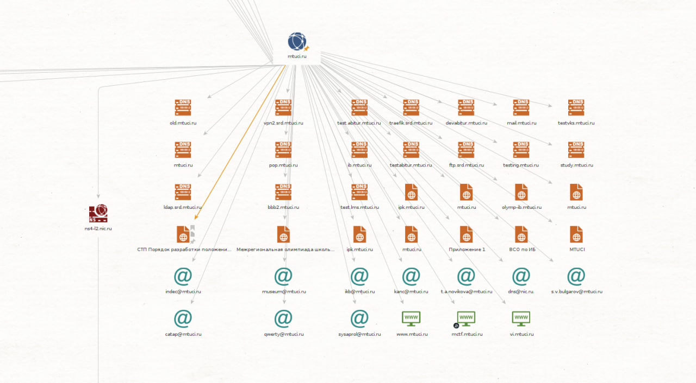
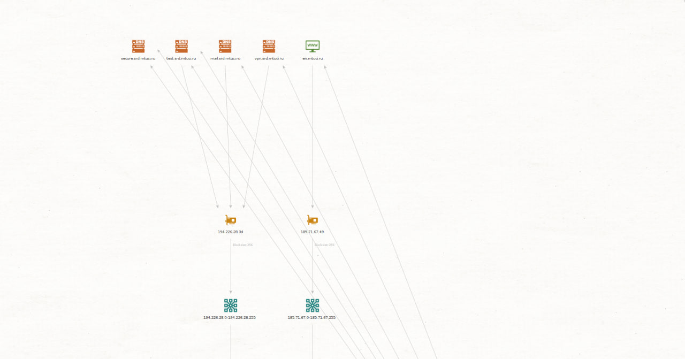

### Задание 1

Используйте инструменты OSINT и найдите информацию о любом сервисе, которым пользуйтесь каждый день.

Рекомендуем искать:

    расположение дата-центров;
    почтовые сервера;
    чаты;
    файлы в открытом доступе;
    адреса офисов;
    ресурсы, где можно найти сотрудников компании и т. д.

Напишите отчёт о найденной информации, которая могла бы быть использована для пентеста.
### Задание 2

- Проведите первичный пентест уязвимого приложения Google Gruyere с помощью OWASP ZAP или Burp Suite. 
- Найдите в приложениях XSS, XSRF, XSSI, Path Tracersal и Code Execution. Какая-то часть уязвимостей может быть найдена автоматически, другая часть найдётся только вручную. 

Не рекомендуем пользоваться ответами, но можно посмотреть в подсказки.
[Google Gruyere](https://google-gruyere.appspot.com/).

Пришлите отчёт о том:
- каким образом вы смогли найти уязвимости;
- как можно эксплуатировать эти уязвимости приложений.

## ОТЧЕТ

### Задание 1
Будем проверять сайт mtuci.ru

# 1 Доменные имена
Самое первое и простое что мы можем сделать — это порезолвить доменные имена. Для этого есть десятки утилит, как терминальных так и доступных онлайн.
```
Server:         1.1.1.1
Address:        1.1.1.1#53

Non-authoritative answer:
Name:   mtuci.ru
Address: 185.71.67.49
```

```
dig @8.8.8.8 mtuci.ru  ANY      

; <<>> DiG 9.20.4-4-Debian <<>> @8.8.8.8 mtuci.ru ANY
; (1 server found)
;; global options: +cmd
;; Got answer:
;; ->>HEADER<<- opcode: QUERY, status: NOERROR, id: 6082
;; flags: qr rd ra; QUERY: 1, ANSWER: 1, AUTHORITY: 0, ADDITIONAL: 1

;; OPT PSEUDOSECTION:
; EDNS: version: 0, flags:; udp: 512
;; QUESTION SECTION:
;mtuci.ru.                      IN      ANY

;; ANSWER SECTION:
mtuci.ru.               300     IN      A       185.71.67.49

;; Query time: 104 msec
;; SERVER: 8.8.8.8#53(8.8.8.8) (TCP)
;; WHEN: Mon Feb 03 06:08:12 EST 2025
;; MSG SIZE  rcvd: 53
```

Что это нам дает?

Помимо соответствия IP-адрес—домен мы можем узнать, например, DNS-серверы, с помощью утилиты nslookup, а также можем получить все DNS-записи, например, командой dig.

# 2 Whois
Whois — протокол, основная цель которого заключается в получении регистрационных данных о владельцах доменных имён, IP-адресах и автономных систем (ASN).

```
whois mtuci.ru                                                                                      
% TCI Whois Service. Terms of use:
% https://tcinet.ru/documents/whois_ru_rf.pdf (in Russian)
% https://tcinet.ru/documents/whois_su.pdf (in Russian)

domain:        MTUCI.RU
nserver:       ns3-l2.nic.ru.
nserver:       ns4-cloud.nic.ru.
nserver:       ns4-l2.nic.ru.
nserver:       ns8-cloud.nic.ru.
nserver:       ns8-l2.nic.ru.
state:         REGISTERED, DELEGATED, VERIFIED
org:           Moscow Technical University of Communications and Informatics (MTUCI)
taxpayer-id:   7722000820
registrar:     RU-CENTER-RU
admin-contact: https://www.nic.ru/whois
created:       1996-10-16T10:15:23Z
paid-till:     2025-10-31T21:00:00Z
free-date:     2025-12-02
source:        TCI

Last updated on 2025-02-03T11:08:01Z
```
Что это нам дает?

Из вывода Whois можно получить email-адреса владельцев и администраторов, адреса DNS-серевров, подсети и ASN.

# 3 Maltego
Maltego- программное обеспечение, используемое для разветки и криминалистики с открытым кодом.

Благодаря ему соберем всю информацию(ip,dns,файлы, фио людей на сайтах)





На изображениях видно, что домен mtuci.ru имеет множество субдоменов, включая:
 • secure.srd.mtuci.ru
 • test.srd.mtuci.ru
 • mail.srd.mtuci.ru
 • vpn.srd.mtuci.ru
 • ldap.srd.mtuci.ru
 • ftp.srd.mtuci.ru
 • study.mtuci.ru
 • и другие.

Это указывает на используемую инфраструктуру, включающую почтовые, VPN, LDAP, FTP и другие сервисы. Такие сведения могут быть использованы злоумышленниками для поиска слабых мест.

2. IP-адреса и блоки
 • 194.226.28.34 (диапазон 194.226.28.0/24)
 • 185.71.67.49 (диапазон 185.71.67.0/24)

Эти IP-адреса могут принадлежать внешним сервисам или серверам, связанным с инфраструктурой MTUCI. Определение IP-адресов позволяет атакующим строить атаки на основе уязвимостей сервисов, работающих на этих адресах.

3. Признаки потенциальных угроз
 1. VPN-сервисы (vpn.srd.mtuci.ru, vpn2.srd.mtuci.ru)
 • Возможная цель атак на утечки учетных данных (Brute-force, Password Spraying).
 • Можно проверить утечки учетных записей с использованием OSINT-ресурсов (например, haveibeenpwned.com).
 2. LDAP (ldap.srd.mtuci.ru)
 • Используется для аутентификации. Если открыт в интернет, может быть уязвим к атакам (LDAP injection).
 3. FTP (ftp.srd.mtuci.ru)
 • Возможные проблемы с безопасностью, особенно если используется anonymous FTP.
 4. Почта (mail.srd.mtuci.ru)
 • Возможность фишинговых атак, компрометации учетных записей.
 • Можно проверить SPF, DKIM, DMARC записи для защиты.

4. Потенциальные рекомендации по защите
 • Закрыть неиспользуемые сервисы от внешнего доступа.
 • Проверить конфигурации VPN и LDAP (MFA, ограничение доступа).
 • Настроить мониторинг несанкционированных попыток входа.
 • Проверить субдомены на уязвимости (subdomain takeover, open ports).


------

### Задание 2
Сканируем приложение: https://google-gruyere.appspot.com/561343933704307424955848114688252962122/

### 1. Найдите в приложениях XSS

Межсайтовый скриптинг (XSS) - это уязвимость, которая позволяет злоумышленнику внедрять код (обычно HTML или JavaScript) в содержимое веб-сайта, находящегося вне контроля злоумышленника. Когда жертва просматривает такую страницу, введенный код выполняется в браузере жертвы. Таким образом, злоумышленник обошел политику того же источника браузера и может украсть личную информацию жертвы, связанную с рассматриваемым веб-сайтом.

#### 1-1) Уязвимость через адресную строку:
https://google-gruyere.appspot.com/380075102534537954520940078031300502308/snippets.gtl?uid=+%3Cscript%3Ealert('Finded XSS')%3C/script%3E


#### 1-2) File Upload XSS
Создаем файл xss.html с содержимым
```text
<script>
alert(document.cookie);
</script>
```

Загружаем его и получаем адрес его размещения
https://google-gruyere.appspot.com/380075102534537954520940078031300502308/alex/xss.html
Переходим на адрес и видим куки приложения


#### 1-3) Reflected XSS


#### 1-4) Stored XSS
создать файл с содержимым
```text
<p <script>alert(1)</script>hello
```
загружаем его
https://google-gruyere.appspot.com/380075102534537954520940078031300502308/alex/stored xss.html
запускаем ссылку


### 2. XSRF

Когда браузер отправляет запросы на сайт, он всегда отправляет все файлы cookie, которые у него есть для этого сайта, независимо от того, откуда поступает запрос. 
Кроме того, веб-серверы обычно не могут отличить запрос, инициированный преднамеренным действием пользователя (например, пользователь нажимает на кнопку "Отправить"), 
от запроса, выполненного браузером без действия пользователя (например, запрос на встроенное изображение на странице). 
Поэтому, если сайт получает запрос на выполнение какого—либо действия (например, удаление почты, изменение контактного адреса), он не может знать, 
было ли это действие сознательно инициировано пользователем - даже если запрос содержит файлы cookie для аутентификации. 
Злоумышленник может использовать этот факт, чтобы обмануть сервер и заставить его выполнять действия, которые пользователь не намеревался выполнять.

создаем файл XSRF с содержимым

```text
<h1>Alex page</h1>
<p>Useful information</p>

```

Загружаем этот файл от Алекса получаем на него ссылку
https://google-gruyere.appspot.com/380075102534537954520940078031300502308/alex/xsrf.html


Эту ссылку добавляем в профиль алекса в домашнюю страницу


создаем бобу статьи 


под бобом открываем домашнюю страничку алекса


смотрим дом страницу алекса


### Потом обнаруживаем под бобом что пропала его статья


### 3. XSSI

```text
Браузеры не позволяют страницам одного домена читать страницы в других доменах. Но они не мешают страницам домена ссылаться на ресурсы в других доменах. В частности, они позволяют отображать изображения из других доменов и выполнять скрипты из других доменов. Включенный скрипт не имеет своего собственного контекста безопасности. Он запускается в контексте безопасности страницы, которая его включила. Например, если www.evil.example.com включает в себя скрипт, размещенный на www.google.com затем этот скрипт запускается в контексте evil, а не в контексте Google. Таким образом, любые пользовательские данные в этом скрипте будут "утекать".

Выполняется путем внедрения на сторонний сайт скрипта запускающего скрипты данного сайта
<script>
function _feed(s) {
  alert("Your private snippet is: " + s['private_snippet']);
}
</script>
<script src="https://google-gruyere.appspot.com/561343933704307424955848114688252962122/feed.gtl"></script>
```

#### 3-1-Создаем двух пользователей alex и bob

#### 3-2-Создаем private snippet alex 


#### 3-3-Создаем private snippet  bob


#### 3-4-Создаем файл с содержимым 

```html
<h1>Bob page</h1>
<p>Useful information</p>
<script>
function _feed(s) {
  alert("Your private snippet is: " + s['private_snippet']);
}
</script>
<script src="https://google-gruyere.appspot.com/380075102534537954520940078031300502308/feed.gtl"></script>
```


#### 3-5-Загружаем его как домашнюю страницу боба


#### 3-6 Под alex открываем дом страницу bob и видим его частный комментарий.


### 4. Path Traversal

Большинство веб-приложений обслуживают статические ресурсы, такие как изображения и CSS-файлы. Часто приложения просто обслуживают все файлы в папке. Если приложение не будет осторожным, пользователь может использовать атаку обхода пути для чтения файлов из других папок, к которым у него не должно быть доступа. Например, как в Windows, так и в Linux .. представляет родительский каталог, поэтому, если вы можете ввести ../ в путь, вы можете "сбежать" в родительский каталог.

#### 4-1 Cоздать пользователя с именем ..


#### 4-2 Загрузить файл от имени этого пользователя secret.txt


https://google-gruyere.appspot.com/380075102534537954520940078031300502308/../secret.txt

#### 4-3 Получить файл по пути

https://google-gruyere.appspot.com/380075102534537954520940078031300502308%2f..%2fsecret.txt


### 5. Code Execution

#### 5-1 Cоздать пользователя с именем ..


#### 5-2 Загрузить файл от имени этого пользователя gtl.py


#### 5-3 Содержимое gtl.py на сервере поменялось

До загрузки:


После загрузки:


#### 5-4 И сервер больше не стартует


#### Потому что изломали скрипт

------


---

[← Все работы](../../README.md)

[Все изображения работы](IMAGES.md)
