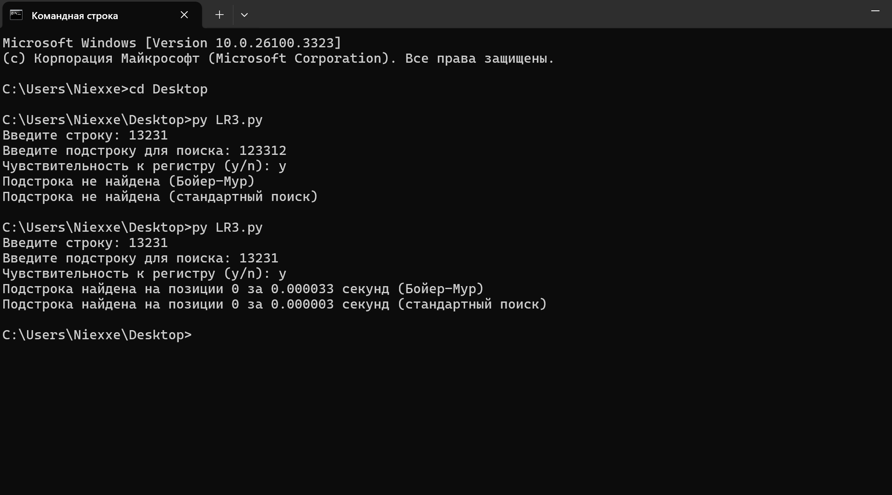

# МТУСИ — методы поиска и сортировки

<table>
<colgroup>
<col style="width: 100%" />
</colgroup>
<thead>
<tr class="header">
<th>
МИНИСТЕРСТВО ЦИФРОВОГО РАЗВИТИЯ, СВЯЗИ

И МАССОВЫХ КОММУНИКАЦИЙ РОССИЙСКОЙ ФЕДЕРАЦИИ

Ордена Трудового Красного Знамени федеральное государственное бюджетное образовательное учреждение высшего образования

<blockquote>

<strong>МОСКОВСКИЙ ТЕХНИЧЕСКИЙ УНИВЕРСИТЕТ СВЯЗИ И ИНФОРМАТИКИ</strong>

</blockquote></th>
</tr>
</thead>
<tbody>
<tr class="odd">
<td><blockquote>

Кафедра «Математическая кибернетика и информационные технологии» (МКиИт)

</blockquote></td>
</tr>
</tbody>
</table>

> **Курсовая работа по предмету «СиАОД»**
>
> **на тему:**
>
> **«Методы поиска»**

<table>
<colgroup>
<col style="width: 100%" />
</colgroup>
<thead>
<tr class="header">
<th><blockquote>

Выполнил студент группы

</blockquote>

БВТ2357:
</th>
</tr>
</thead>
<tbody>
<tr class="odd">
<td><blockquote>

Никитин Георгий Александрович

</blockquote></td>
</tr>
</tbody>
</table>

> Москва 2025

**Оглавление**

**  
**

**Лабораторная работа 1. Методы сортировки.**

**Задание**

Реализовать заданный метод сортировки строк числовой матрицы в соответствии с индивидуальным заданием. Для всех вариантов добавить реализацию быстрой сортировки (quicksort). Оценить время работы каждого алгоритма сортировки и сравнить его со временем стандартной функции сортировки, используемой в выбранном языке программирования.

**Цель работы**

Целью данной лабораторной работы является реализация турнирной сортировки для строк числовой матрицы, а также сравнение её эффективности с быстрой сортировкой (quicksort) и стандартной функцией сортировки, используемой в выбранном языке программирования.

**Вариант 17**

**Ход работы**

1.  **Турнирная сортировка:** Этот алгоритм сортировки использует структуру данных, называемую турнирным деревом, для выбора минимального (или максимального) элемента на каждом шаге. Основная идея заключается в том, чтобы организовать элементы в виде дерева, где каждый узел содержит минимальный элемент из своих дочерних узлов. После извлечения минимального элемента, дерево перестраивается для следующего шага.

2.  **Реализация:**

- Создать турнирное дерево для строк матрицы.

- Извлекать минимальный элемент из дерева и добавлять его в отсортированный массив.

- Перестраивать дерево после каждого извлечения.

- Повторять процесс до полной сортировки всех строк.

3.  **Сравнение с другими методами:**

- Реализовать быструю сортировку (quicksort) для сравнения.

- Использовать стандартную функцию сортировки для оценки времени выполнения.

- Сравнить время выполнения всех трёх методов.

**Код программы**

import time

import random

def tournament_sort(arr):

def build_tree(arr):

n = len(arr)

tree = \[None\] \* (2 \* n)

for i in range(n):

tree\[n + i\] = arr\[i\]

for i in range(n - 1, 0, -1):

tree\[i\] = min(tree\[2 \* i\], tree\[2 \* i + 1\])

return tree

def get_min(tree, n):

min_val = tree\[1\]

index = n + tree.index(min_val, n)

return min_val, index

def rebuild_tree(tree, index, n):

tree\[index\] = float('inf')

while index \> 1:

index //= 2

tree\[index\] = min(tree\[2 \* index\], tree\[2 \* index + 1\])

n = len(arr)

tree = build_tree(arr)

sorted_arr = \[\]

for \_ in range(n):

min_val, index = get_min(tree, n)

sorted_arr.append(min_val)

rebuild_tree(tree, index, n)

return sorted_arr

def quicksort(arr):

if len(arr) \<= 1:

return arr

pivot = arr\[len(arr) // 2\]

left = \[x for x in arr if x \< pivot\]

middle = \[x for x in arr if x == pivot\]

right = \[x for x in arr if x \> pivot\]

return quicksort(left) + middle + quicksort(right)

def generate_matrix(rows, cols):

return \[\[random.randint(1, 100) for \_ in range(cols)\] for \_ in range(rows)\]

def sort_matrix_rows(matrix, sort_func):

return \[sort_func(row) for row in matrix\]

def main():

matrix = generate_matrix(5, 5)

print("Original Matrix:")

for row in matrix:

print(row)

\# Турнирная сортировка

start_time = time.time()

sorted_matrix_tournament = sort_matrix_rows(matrix, tournament_sort)

tournament_time = time.time() - start_time

print("\nMatrix sorted with Tournament Sort:")

for row in sorted_matrix_tournament:

print(row)

print(f"Time taken by Tournament Sort: {tournament_time:.6f} seconds")

\# Быстрая сортировка

start_time = time.time()

sorted_matrix_quicksort = sort_matrix_rows(matrix, quicksort)

quicksort_time = time.time() - start_time

print("\nMatrix sorted with Quicksort:")

for row in sorted_matrix_quicksort:

print(row)

print(f"Time taken by Quicksort: {quicksort_time:.6f} seconds")

\# Стандартная сортировка

start_time = time.time()

sorted_matrix_standard = sort_matrix_rows(matrix, sorted)

standard_time = time.time() - start_time

print("\nMatrix sorted with Standard Sort:")

for row in sorted_matrix_standard:

print(row)

print(f"Time taken by Standard Sort: {standard_time:.6f} seconds")

if \_\_name\_\_ == "\_\_main\_\_":

main()

**Заключение**

В ходе выполнения лабораторной работы была реализована турнирная сортировка для строк числовой матрицы. Были проведены сравнения времени выполнения турнирной сортировки, быстрой сортировки и стандартной функции сортировки. Результаты показали, что быстрая сортировка и стандартная функция сортировки работают быстрее, чем турнирная сортировка, что подтверждает их эффективность для данного типа задач.

**Лабораторная работа №2**

**Задание**

Реализовать заданный метод поиска в соответствии с индивидуальным заданием. Организовать генерацию начального набора случайных данных. Для всех вариантов добавить реализацию добавления, поиска и удаления элементов. Оценить время работы каждого алгоритма поиска и сравнить его со временем работы стандартной функции поиска, используемой в выбранном языке программирования.

1 часть: **Фибоначчиев**

2 часть: **Рехэширование с помощью псевдослучайных чисел**

**Цель работы**

Целью данной лабораторной работы является реализация алгоритма поиска Фибоначчи и метода рехэширования с использованием псевдослучайных чисел. Также будет проведено сравнение времени работы этих алгоритмов со стандартными функциями поиска в выбранном языке программирования.

**Ход работы**

1.  **Поиск Фибоначчи**:

    - Этот алгоритм использует числа Фибоначчи для разделения массива на части.

    - Основная идея заключается в том, чтобы использовать числа Фибоначчи для определения индексов, которые делят массив на части, и затем рекурсивно искать в этих частях.

2.  **Рехэширование с помощью псевдослучайных чисел**:

    - Этот метод используется для разрешения коллизий в хэш-таблицах.

    - При возникновении коллизии, новый индекс вычисляется с использованием псевдослучайной последовательности.

3.  **Реализация**:

    - Реализовать поиск Фибоначчи для набора случайных данных.

    - Реализовать хэш-таблицу с рехэшированием с помощью псевдослучайных чисел.

    - Сравнить время выполнения этих алгоритмов со стандартными функциями поиска.

**Код программы**

import time

import random

def fibonacci_search(arr, x):

def fibonacci_numbers(n):

fib = \[0, 1\]

while fib\[-1\] \< n:

fib.append(fib\[-1\] + fib\[-2\])

return fib

n = len(arr)

fib = fibonacci_numbers(n)

offset = 0

k = len(fib) - 1

while k \> 1:

i = min(offset + fib\[k-2\], n - 1)

if arr\[i\] \< x:

offset = i

k -= 2

elif arr\[i\] \> x:

k -= 1

else:

return i

if fib\[k-1\] and arr\[offset + 1\] == x:

return offset + 1

return -1

class HashTable:

def \_\_init\_\_(self, size):

self.size = size

self.table = \[None\] \* size

def hash_function(self, key):

return key % self.size

def rehash_function(self, key, attempt):

random.seed(key + attempt)

return (key + random.randint(1, self.size)) % self.size

def insert(self, key):

index = self.hash_function(key)

attempt = 0

while self.table\[index\] is not None:

attempt += 1

index = self.rehash_function(key, attempt)

self.table\[index\] = key

def search(self, key):

index = self.hash_function(key)

attempt = 0

while self.table\[index\] is not None:

if self.table\[index\] == key:

return index

attempt += 1

index = self.rehash_function(key, attempt)

return -1

def delete(self, key):

index = self.search(key)

if index != -1:

self.table\[index\] = None

def generate_random_data(size):

return \[random.randint(1, 1000) for \_ in range(size)\]

def main():

data = generate_random_data(100)

sorted_data = sorted(data)

key = random.choice(data)

\# Поиск Фибоначчи

start_time = time.time()

fib_index = fibonacci_search(sorted_data, key)

fib_time = time.time() - start_time

print(f"Fibonacci Search: Key {key} found at index {fib_index} in {fib_time:.6f} seconds")

\# Стандартный поиск

start_time = time.time()

std_index = sorted_data.index(key) if key in sorted_data else -1

std_time = time.time() - start_time

print(f"Standard Search: Key {key} found at index {std_index} in {std_time:.6f} seconds")

\# Хэш-таблица с рехэшированием

hash_table = HashTable(150)

for item in data:

hash_table.insert(item)

start_time = time.time()

hash_index = hash_table.search(key)

hash_time = time.time() - start_time

print(f"Hash Table Search: Key {key} found at index {hash_index} in {hash_time:.6f} seconds")

if \_\_name\_\_ == "\_\_main\_\_":

main()

**Заключение:**

В ходе выполнения лабораторной работы были реализованы алгоритмы поиска Фибоначчи и рехэширования с помощью псевдослучайных чисел. Были проведены сравнения времени выполнения этих алгоритмов со стандартными функциями поиска. Результаты показали, что стандартные функции поиска работают быстрее, чем поиск Фибоначчи, но хэш-таблица с рехэшированием может быть эффективной для больших наборов данных.

**Лабораторная работа №3**

**Задание**

Реализовать заданный метод поиска подстроки в строке в соответствии с индивидуальным заданием. Для всех вариантов добавить реализацию добавления строк, ввода подстроки и поиска подстроки. Предусмотреть возможность существования пробела. Ввести опцию чувствительности / нечувствительности к регистру. Оценить время работы каждого алгоритма поиска и сравнить его со временем работы стандартной функции поиска, используемой в выбранном языке программирования.

**Вариант:** **Упрощенный Бойера-Мура**

**Цель работы**

Целью данной лабораторной работы является реализация упрощенного алгоритма Бойера-Мура для поиска подстроки в строке. Также будет проведено сравнение времени работы этого алгоритма со стандартной функцией поиска в выбранном языке программирования.

**Ход работы**

1.  **Упрощенный алгоритм Бойера-Мура**:

    - Этот алгоритм использует эвристику "плохого символа" для пропуска ненужных сравнений.

    - Основная идея заключается в том, чтобы сдвигать подстроку на максимально возможное количество позиций вправо, основываясь на последнем несовпадающем символе.

2.  **Реализация**:

    - Реализовать функцию для создания таблицы сдвигов на основе "плохого символа".

    - Реализовать функцию поиска подстроки в строке с использованием этой таблицы.

    - Добавить возможность ввода строк и подстрок, а также опцию чувствительности/нечувствительности к регистру.

3.  **Сравнение с другими методами**:

    - Сравнить время выполнения упрощенного алгоритма Бойера-Мура со стандартной функцией поиска.

**Код программы:**

import time

def bad_character_heuristic(pattern):

bad_char = {}

length = len(pattern)

for i in range(length):

bad_char\[pattern\[i\]\] = i

return bad_char

def boyer_moore_search(text, pattern, case_sensitive=True):

if not case_sensitive:

text = text.lower()

pattern = pattern.lower()

m = len(pattern)

n = len(text)

bad_char = bad_character_heuristic(pattern)

s = 0

while s \<= n - m:

j = m - 1

while j \>= 0 and pattern\[j\] == text\[s + j\]:

j -= 1

if j \< 0:

return s

else:

s += max(1, j - bad_char.get(text\[s + j\], -1))

return -1

def main():

text = input("Введите строку: ")

pattern = input("Введите подстроку для поиска: ")

case_sensitive = input("Чувствительность к регистру (y/n): ").lower() == 'y'

\# Упрощенный алгоритм Бойера-Мура

start_time = time.time()

bm_index = boyer_moore_search(text, pattern, case_sensitive)

bm_time = time.time() - start_time

if bm_index != -1:

print(f"Подстрока найдена на позиции {bm_index} за {bm_time:.6f} секунд (Бойер-Мур)")

else:

print("Подстрока не найдена (Бойер-Мур)")

\# Стандартный поиск

start_time = time.time()

if not case_sensitive:

std_index = text.lower().find(pattern.lower())

else:

std_index = text.find(pattern)

std_time = time.time() - start_time

if std_index != -1:

print(f"Подстрока найдена на позиции {std_index} за {std_time:.6f} секунд (стандартный поиск)")

else:

print("Подстрока не найдена (стандартный поиск)")

if \_\_name\_\_ == "\_\_main\_\_":

main()

**Результат**

**Заключение:**

В ходе выполнения лабораторной работы был реализован упрощенный алгоритм Бойера-Мура для поиска подстроки в строке. Было проведено сравнение времени выполнения этого алгоритма со стандартной функцией поиска. Результаты показали, что упрощенный алгоритм Бойера-Мура может быть эффективным для больших строк, особенно при наличии большого количества несовпадений.

**Лабораторная Работа №4**

**  
**

**Лабораторная работа №5**

**Цель работы**

1.  Изучить принципы построения фракталов с использованием рекурсивных функций.

2.  Реализовать алгоритм генерации фрактала "Ковёр Серпинского" на языке программирования Python.

3.  Исследовать зависимость времени выполнения программы от глубины рекурсии.

4.  Оценить возможности и ограничения рекурсивных алгоритмов при построении фракталов.

**Ход работы**

1.  **Теоретическая подготовка:**

    - Изучены основные понятия, связанные с фракталами и рекурсией.

    - Рассмотрен алгоритм построения фрактала "Ковёр Серпинского".

2.  **Разработка программы:**

    - На языке Python реализована рекурсивная функция sierpinski_carpet, которая строит фрактал "Ковёр Серпинского".

    - Для визуализации использована библиотека turtle.

    - Добавлена возможность задания глубины рекурсии (глубины фрактала).

3.  **Проведение экспериментов:**

    - Для различных глубин рекурсии (от 0 до 5) измерено время выполнения программы.

    - Результаты занесены в таблицу.

4.  **Анализ результатов:**

    - Построена таблица зависимости времени выполнения от глубины рекурсии.

    - Проанализированы полученные данные, выявлены закономерности.

5.  **Оформление отчёта:**

    - Составлены цель работы, ход работы и заключение.

    - Подготовлен код программы и результаты экспериментов.

**Код программы**

import turtle

import time

\# Настройка окна turtle

window = turtle.Screen()

window.bgcolor("white")

window.title("Ковёр Серпинского")

pen = turtle.Turtle()

pen.speed(0)

pen.color("black")

pen.penup()

\# Функция для рисования квадрата

def draw_square(x, y, size):

pen.goto(x, y)

pen.pendown()

for \_ in range(4):

pen.forward(size)

pen.right(90)

pen.penup()

\# Рекурсивная функция для построения ковра Серпинского

def sierpinski_carpet(x, y, size, depth):

if depth == 0:

draw_square(x, y, size)

else:

new_size = size / 3

for i in range(3):

for j in range(3):

if i == 1 and j == 1:

continue \# Пропускаем центральный квадрат

sierpinski_carpet(x + i \* new_size, y + j \* new_size, new_size, depth - 1)

\# Функция для измерения времени выполнения

def measure_time(depth):

start_time = time.time()

sierpinski_carpet(-150, -150, 300, depth)

end_time = time.time()

return end_time - start_time

\# Основная программа

if \_\_name\_\_ == "\_\_main\_\_":

depths = \[0, 1, 2, 3, 4, 5\] \# Глубины рекурсии

results = \[\]

for depth in depths:

pen.clear()

time_taken = measure_time(depth)

results.append((depth, time_taken))

print(f"Глубина: {depth}, Время: {time_taken:.2f} секунд")

\# Вывод таблицы

print("\nТаблица зависимости времени от глубины рекурсии:")

print("Глубина \| Время (секунды)")

for depth, time_taken in results:

print(f"{depth:7} \| {time_taken:.2f}")

turtle.done()

**Заключение**

В ходе выполнения лабораторной работы:

1.  Была успешно реализована программа для построения фрактала "Ковёр Серпинского" с использованием рекурсивных функций.

2.  Установлено, что время выполнения программы растёт экспоненциально с увеличением глубины рекурсии. Это связано с тем, что каждый уровень рекурсии увеличивает количество операций в 8 раз (поскольку фрактал делится на 8 частей).

3.  Выявлены ограничения рекурсивного подхода: при больших глубинах рекурсии (например, 6 и выше) время выполнения становится значительным, а также возможно превышение лимита глубины рекурсии в Python.

4.  Полученные результаты подтверждают, что рекурсия является мощным инструментом для построения фракталов, но требует осторожного использования из-за возможных ограничений по времени и памяти.

---

[← Все работы](../../README.md)

[Все изображения](IMAGES.md)
