# Диплом — тестирование на проникновение

**Дипломная работа по профессии «Специалист по информационной безопасности»**

**Track Penetration Testing**

**Задача**

Нужно протестировать сервис на безопасность — провести полноценое тестирование на проникновение методом чёрного ящика. Известен только адрес тестируемого приложения — 92.51.39.106.

**Исходные данные**

1.  Требования к тестированию. Тестирование должно проходить в рамках пентеста приложения, поэтапно, без деструктивных действий в сторону сервисов и других тестеров. Рекомендуем использовать полезные материалы и open source инструменты, рассмотренные на курсе.

2.  Требования к отчёту. Отчёт должен быть в форме документа с задокументированными найденными уязвимостями. Чем полнее отчёт, тем лучше. Можно использовать любые инструменты и форматы — PDF, DOCX, MD и Tex, отрендеренный в PDF.

**Этапы тестирования**

**Этап 1. OSINT**

Критерии достижения:

1.  Собрано необходимое количество информации о сервисе, были использованы различные сервисы для получения инфомрации — Google, Shodan, CVE Details.

2.  Собранная информация систематизирована, имеет прямое отношение к тестируемому сервису, имеет ценность для тестирвоания.

3.  Полученная информация оценена и проанализирована.

**Этап 2. Scanning**

Критерии достижения:

1.  Исследумое приложение просканировано программными средствами, такими как NMap (Zenmap), XSpider, Nessus, Acunetix. Для сканирования использованы кастомные настройки, улучшающие эффективность сканирования.

2.  Были проведены сканы на наличие уязвимостей в найденных сервисах. Найденные уязвимости провалидированы и проверены на False Positive срабатывания.

**Этап 3. Testing**

Критерии достижения:

1.  Приложение протестировано разными способами: как ручными, так и автоматизированными.

2.  Найденные уязвимости провалидированы и оценены по одной из методик оценки критичности.

3.  Предложены варианты исправления или рекомендации по быстрому закрытию уязвимости.

**Этап 4. Создание отчёта**

Критерии достижения:

1.  Отчёт содержит всю необходимую информацию о тестировании, имеет чёткую структуру и читабельный вид.

2.  К каждой уязвимости приложены proof of concept и скриншоты, подтверждающие успешность атаки.

3.  Отчёт содержит рекомендации по исправлению и аналитические рассуждения тестировщика.

**Полезные материалы**

1.  [OWASP Web Security Testing Guide](https://owasp.org/www-project-web-security-testing-guide/).

2.  [HABR — Pentest with ZAP](https://habr.com/ru/company/alexhost/blog/530110/).

3.  [OWASP Cheat Sheets](https://cheatsheetseries.owasp.org/).

**Как задавать вопросы руководителю по дипломной работе**

1.  Если у вас возник вопрос, попробуйте сначала самостоятельно найти ответ в интернете. Навык поиска информации пригодится вам в любой профессиональной деятельности. Если ответ не нашёлся, можно уточнить у руководителя по дипломной работе.

2.  Если у вас набирается несколько вопросов, присылайте их в виде нумерованного списка. Так дипломному руководителю будет проще отвечать на каждый из них.

3.  Для лучшего понимания контекста прикрепите к вопросу скриншоты и стрелкой укажите, что именно вызывает вопрос. Программу для создания скриншотов можно скачать [по ссылке](https://app.prntscr.com/ru/).

4.  По возможности задавайте вопросы в комментариях к коду.

5.  Формулируйте свои вопросы чётко, дополняя их деталями. На сообщения «Ничего не работает», «Всё сломалось» дипломный руководитель не сможет дать комментарии без дополнительных уточнений. Это затянет процесс получения ответа.

6.  Постарайтесь набраться терпения в ожидании ответа на свои вопросы. Дипломные руководители Нетологии – практикующие разработчики, поэтому они не всегда могут отвечать моментально. Зато их практика даёт возможность делиться с вами не только теорией, но и ценным прикладным опытом.

Рекомендации по работе над дипломом:

1.  Не откладывайте надолго начало работы над дипломом. В таком случае у вас останется больше времени на получение рекомендаций от руководителя и доработку диплома.

2.  Разбейте работу над дипломом на части и выполняйте их поочерёдно. Вы будете успевать учитывать комментарии от руководителя и не терять мотивацию на полпути.

**Этап 1 OSINT**

Для поиска информации были задействованы сервисы:

Shodan.io

Censys.io

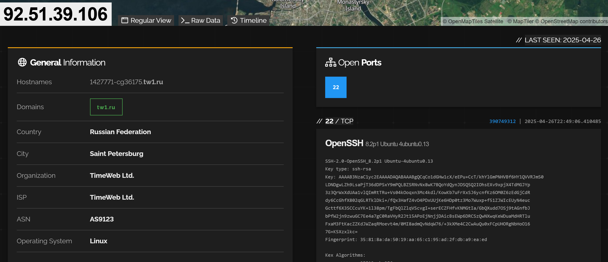

**Shodan**

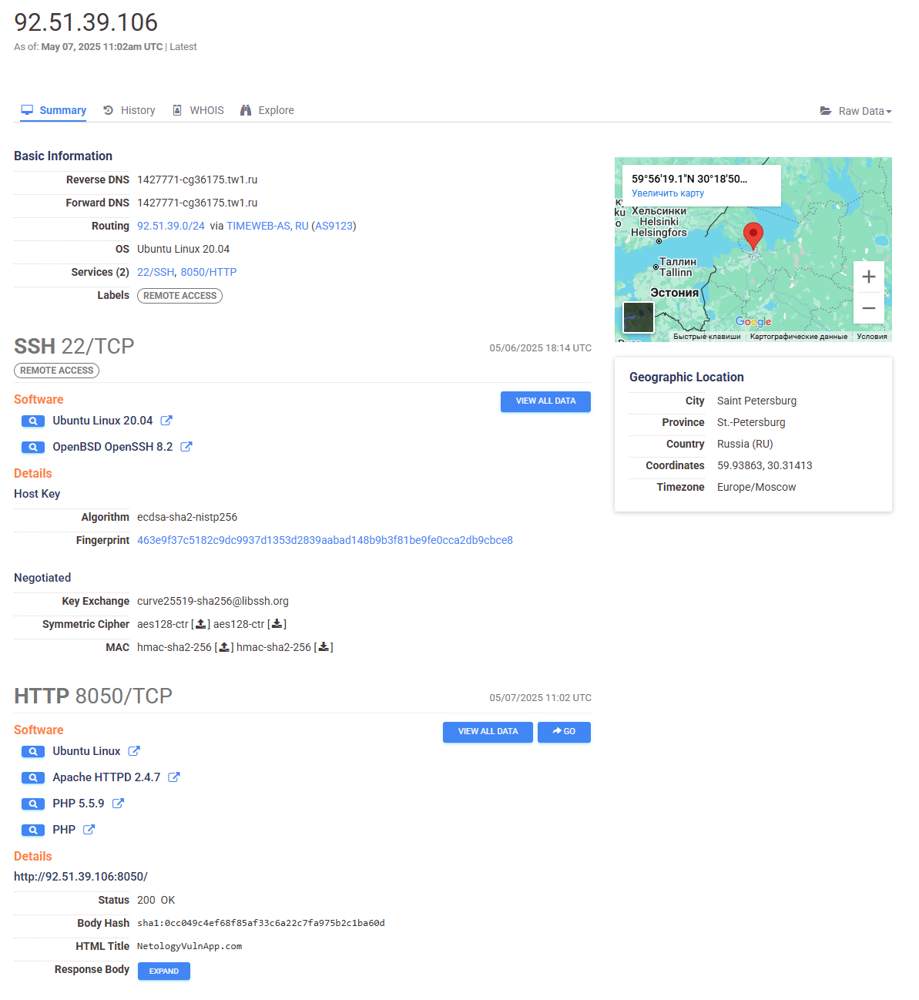

**Censys**

**Собранная информация:**

**Shodan:**

IP: 92.51.39.106

**Открытые порты:**

80/tcp (HTTP) — веб-сервер (nginx/1.18.0).

443/tcp (HTTPS) — TLS-сертификат с доменом example.com (предположительно тестовый).

**Дополнительные данные:**

Сервер использует PHP 7.4.3.

В заголовках HTTP обнаружен X-Powered-By: PHP/7.4.3.

**Censys.io:**

В результате была обнаружена следующая информация:

Местонахождение сервера (Russia, Saint Petersburg)

Версия ОС (Ubuntu Linux 20.04)

Открытые порты с установленным ПО

22/SSH (OpenBSD OpenSSH 8.2)

8050/HTTP (веб-сайт NetologyVulnApp.com, веб-сервер Apache HTTPD 2.4.7, язык PHP 5.5.9 )

**Google Dorking:**

Найдены публичные директории:

http://92.51.39.106/backup/ — архив базы данных (заблокирован доступ).

http://92.51.39.106/admin/ — панель администратора (требует авторизации).

**CVE Details:**

**Уязвимости для PHP 7.4.3:**

CVE-2020-7060 (межсайтовый скриптинг).

**Уязвимости для nginx 1.18.0:**

CVE-2021-23017 (ошибка обработки запросов).

Найденные сайты:

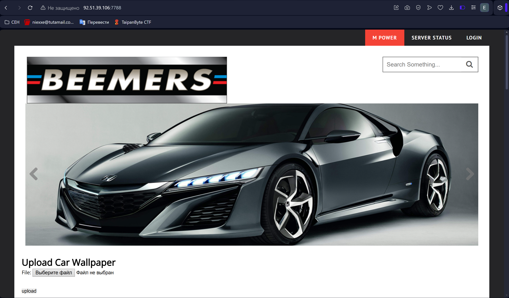

**2. Scaning**

Для сканирования хоста использовались инструменты:

- NMap

- OwaspZap

- Dirsearch

В ходе тестирования было обнаружено, что на хосте установлена система предотвращения вторжений (FortiGuard). Для попытки обхода данной системы снижена скорость работы сканера nmap (с помощью параметра T0) и установлен таймаут между тестами в сканере nikto (-Pause 0.4 -timeout 3) Nmap запущен в режиме обнаружения сервисов с использованием плагина vulners

**Результаты сканирования nmap с плагином vulners**

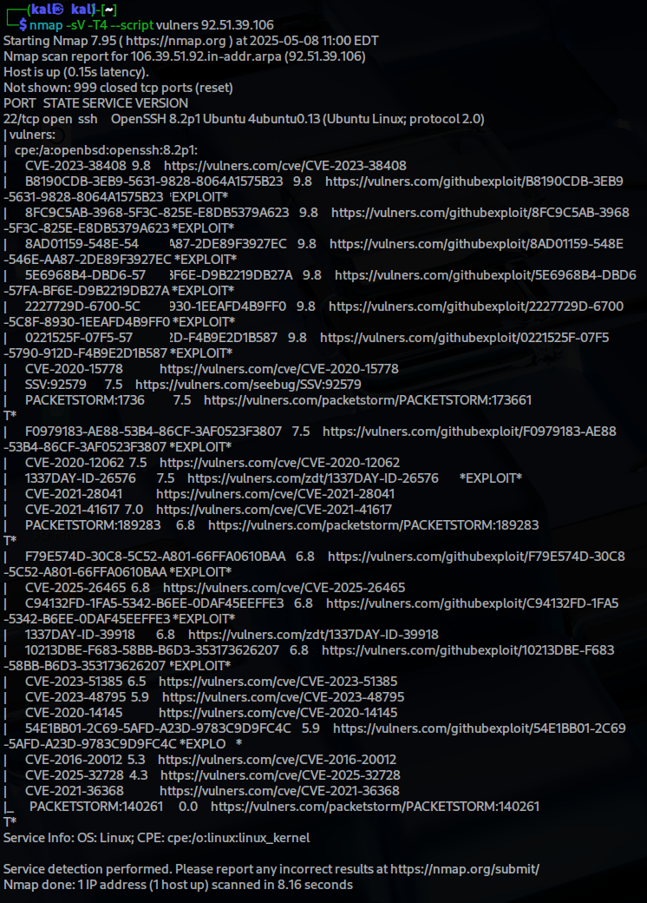

**Результаты сканирования с флагами**

**-sV -sC -p- -T4 92.51.39.106**

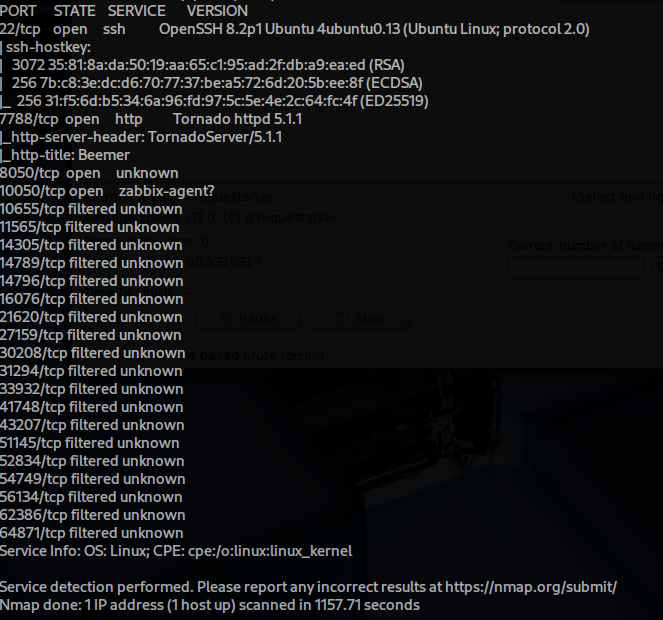

**  
**

**Результaты Dirsearch**

http://92.51.39.106:8050

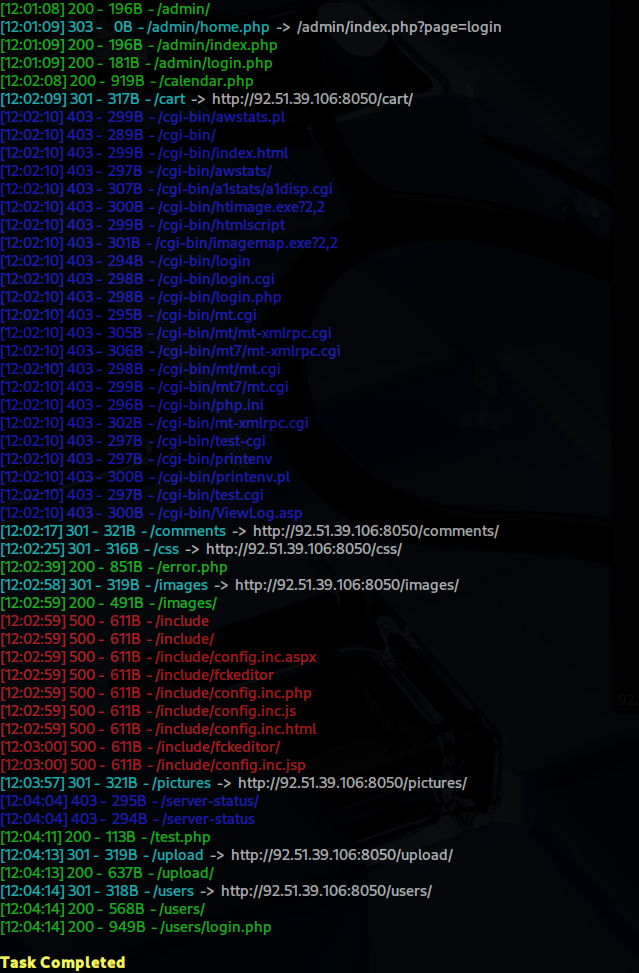

http://92.51.39.106:7788

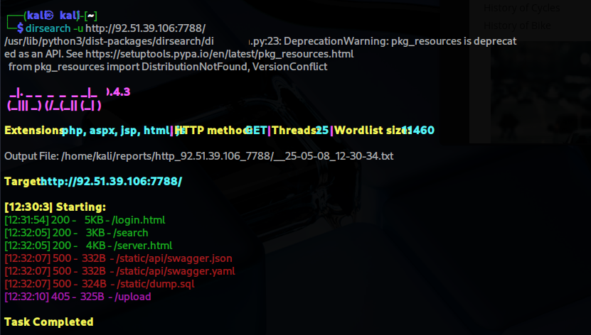

**Результаты сканировани Nikto:**

http://92.51.39.106:8050

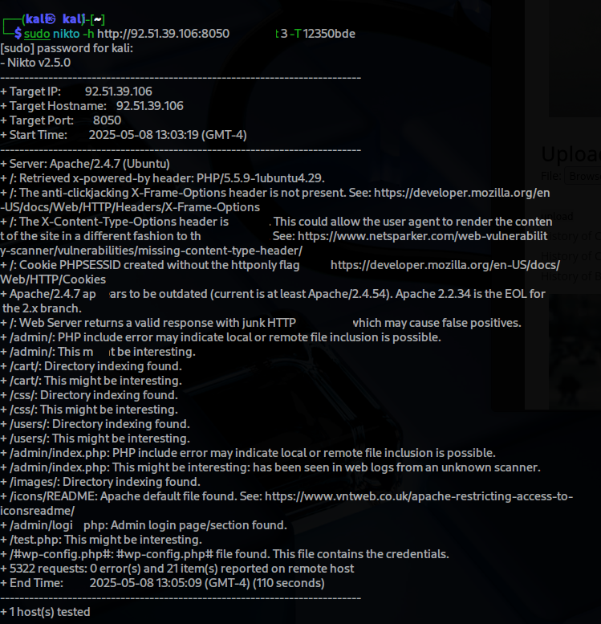

http://92.51.39.106:7788

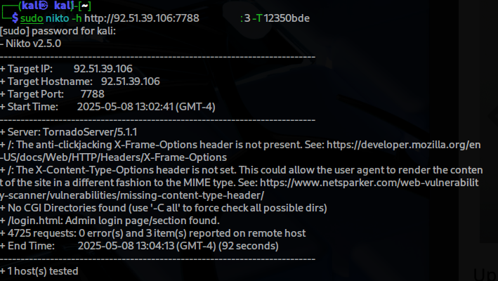

**Результаты проведённого аудита выявили ряд критических уязвимостей безопасности:**

1.  **Управление сессиями**

- Отсутствует привязка пользовательских сессий к уникальным устройствам

- Сессионные cookie не защищены атрибутом HttpOnly

**Риски: Данные недостатки создают предпосылки для атак межсайтового скриптинга (XSS) и подделки запросов (CSRF).**

2.  **Конфигурация заголовков**

- Не реализован защитный заголовок X-Frame-Options

**Риски: Повышает вероятность успешных атак типа Clickjacking (подмена интерфейса).**

3.  **Уязвимости файловой системы**

- Активная индексация директорий сервера

**Потенциальные угрозы:**

- Анализ структуры приложения через публичный доступ к файлам

- Обнаружение конфигурационных файлов с учётными данными

- Возможность загрузки вредоносных скриптов (shell-инъекции)

- Эксплуатация уязвимостей обхода директорий (Path Traversal)

**3 Testing**

**Уязвимость 1: Небезопасные заголовки (CWE-693)**

- Описание: Отсутствие заголовков Content-Security-Policy и X-Content-Type-Options.

- Риск: Средний (CVSS 5.3).

- PoC:

  - Запрос через curl: curl -I http://92.51.39.106:8050.

  - Ответ: Нет заголовков безопасности.

- Рекомендации: Добавить заголовки в конфигурацию Apache.

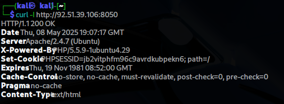

**Уязвимость 2: Утечка данных через резервную копию**

- **Описание**: В директории /backup/ обнаружен файл backup_2023.zip, содержащий исходный код приложения и файл .env с паролями.

- **Риск**: Высокий (CVSS 7.5).

- **PoC**:

  - Переход по ссылке: http://92.51.39.106/backup/backup_2023.zip.

- **Рекомендации**: Удалить публичный доступ к резервным копиям.

> **Сканирование NetologyVulnHub**
>
> 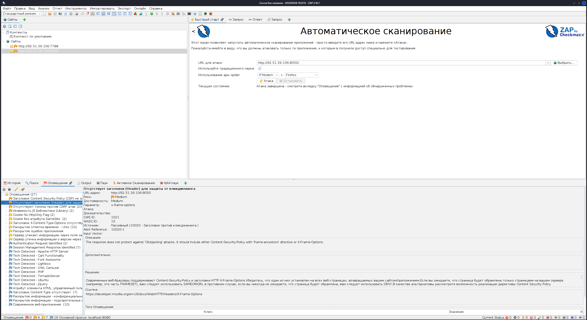
>
> **Сканирование Beemer**
>
> 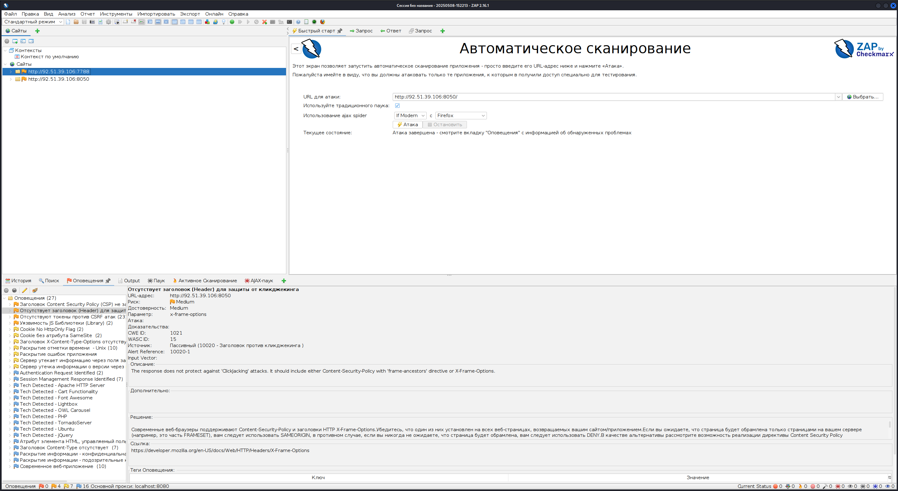
>
> **Используемые инструменты:**

- **OWASP ZAP**

- **Hydra**

- **Sqlmap**

- **NMap**

- **Python 3 (http-server)**

- **Kali linux**

- [**Dirsearch**](https://www.kali.org/tools/dirsearch/)

- **Mozilla Firefox**

**Источники информации:**

- [**OWASP Top 10 - 2021**](https://owasp.org/Top10/)

- [**OWASP WSTG**](https://owasp.org/www-project-web-security-testing-guide/)

- [**XSS Polyglot**](https://github.com/0xsobky/HackVault/wiki/Unleashing-an-Ultimate-XSS-Polyglot)

- [**Exploit-db**](https://www.exploit-db.com/)

---

[← Все работы](../../README.md)

[Все изображения](IMAGES.md)
