# Пентест — отчёт из Word

Задание 1

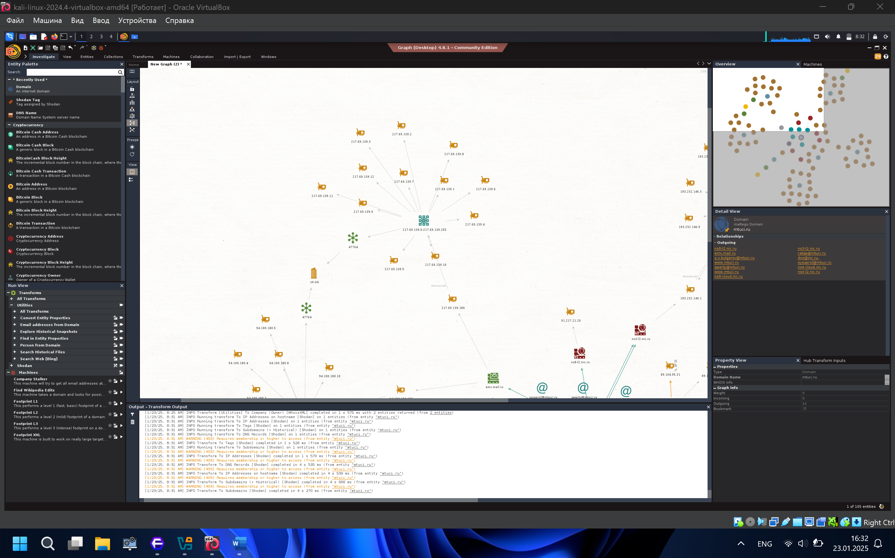

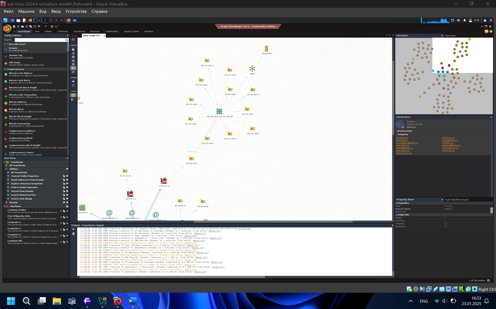

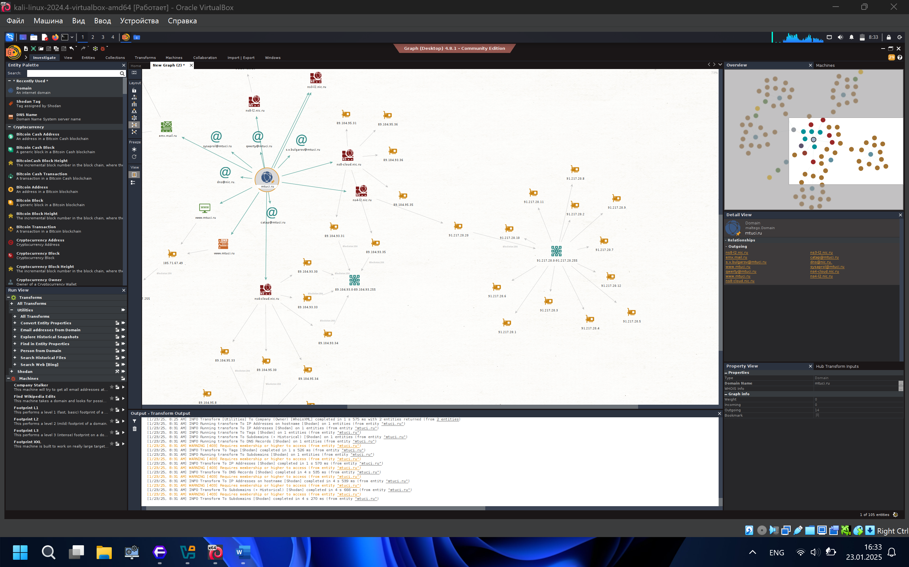

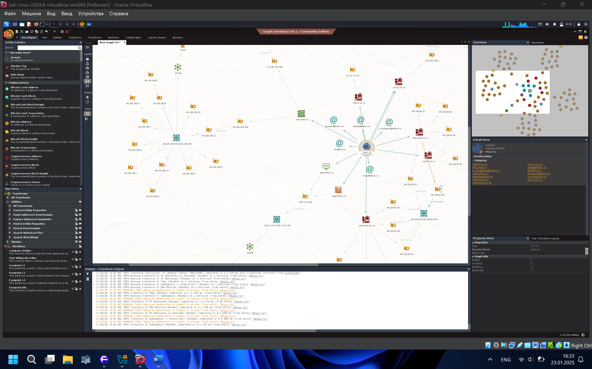

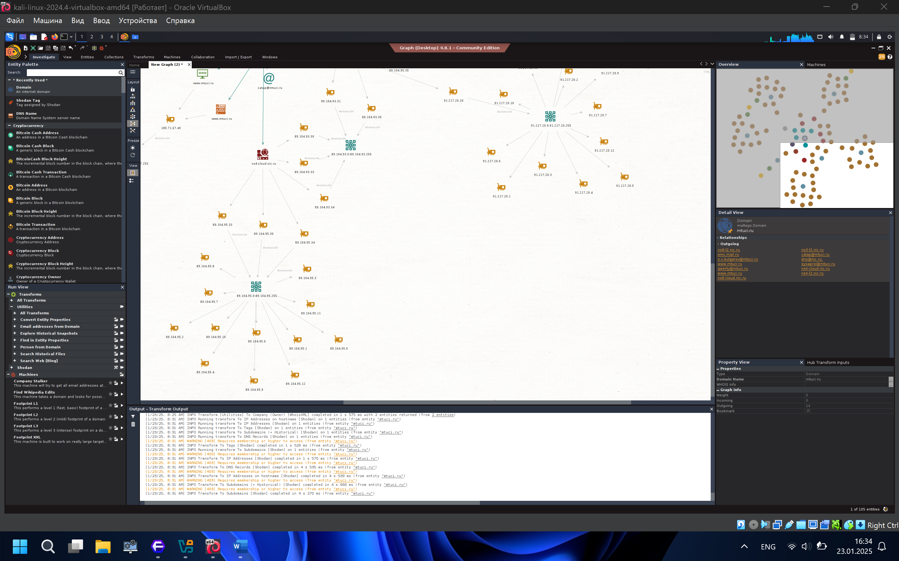

Дата центры расположены в РФ

2\. задание

2.1 XSS

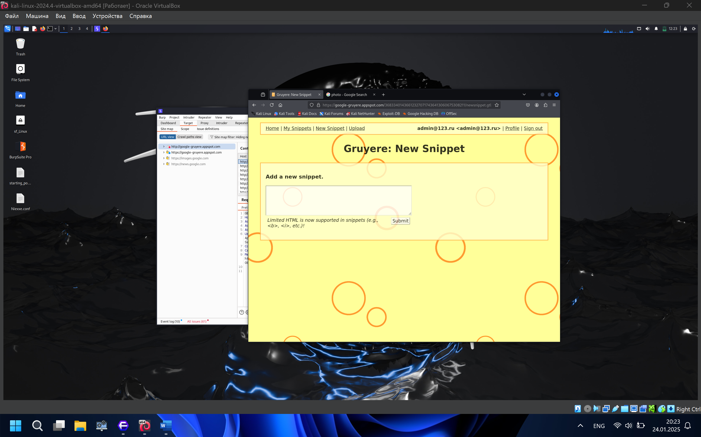

В форму можно попробовать вставить код и попробовать эксплуатировать XSS

\<a href="javascript:alert(String.fromCharCode(88,83,83))"\>Click Me!\</a\>

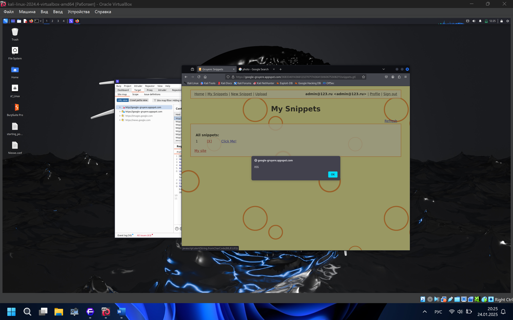

И как видим, все получилось

2.2. XSRF

Заполним форму входа на сайте и перехватим

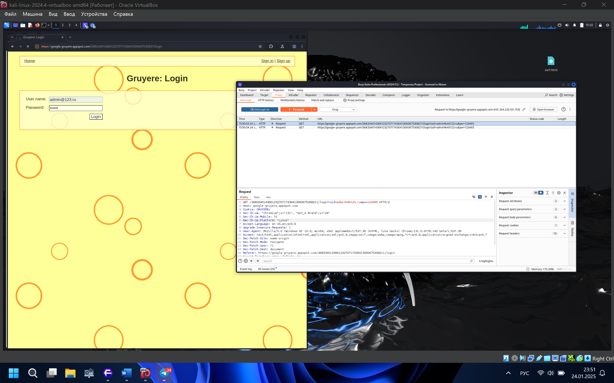

После этого генерируем код и записываем в фаил

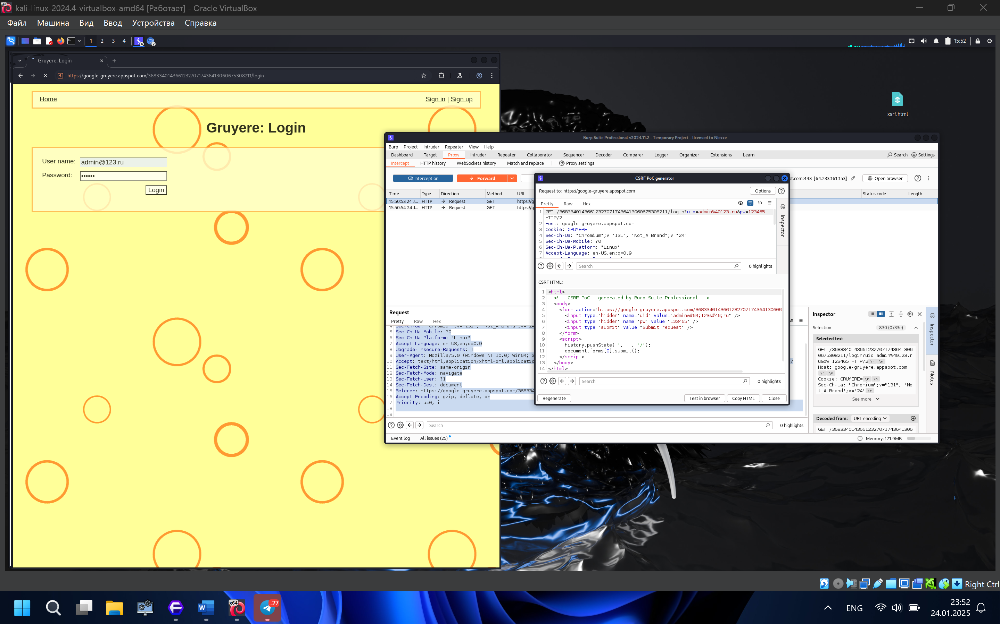

После чего переносим документ

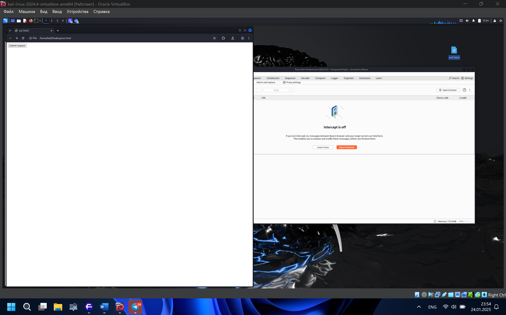

Жмем submit request и вот мы вошли в аккаунт

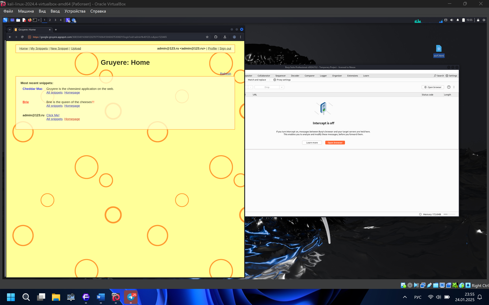

2.3

---

[← Все работы](../../README.md)

[Все изображения](IMAGES.md)
