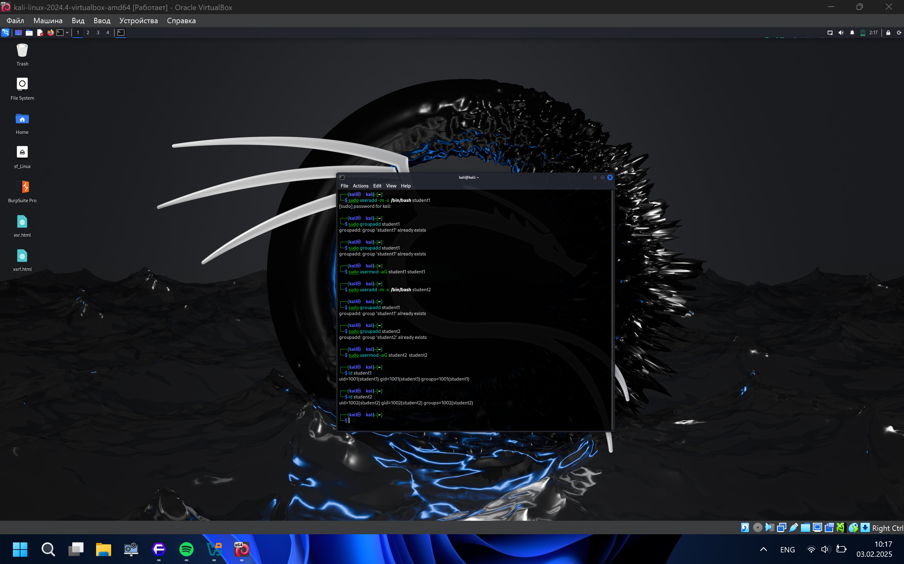
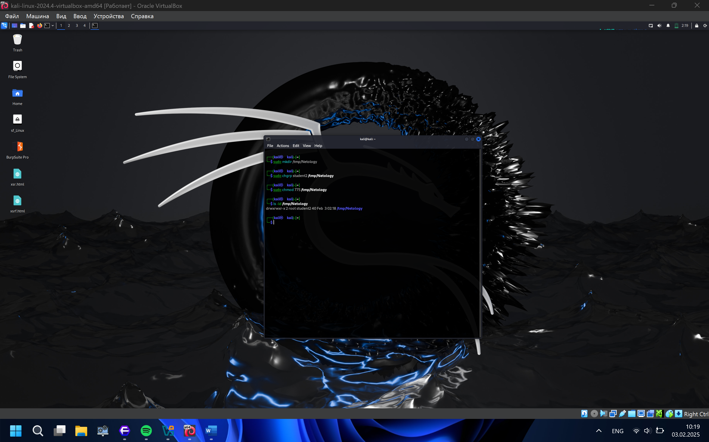

# Linux Hardening

Ex. 1.

Ex. 2.

Ex. 3.

**Объяснение:**

- **/etc/passwd**: Содержит информацию о пользователях (логин, UID, GID, домашний каталог, оболочка). Доступен для чтения всем пользователям.

- **/etc/shadow**: Содержит хэши паролей пользователей. Доступен только для чтения root. Это сделано для повышения безопасности, чтобы хэши паролей не могли быть прочитаны обычными пользователями.

Ex. 4\*.

1.  **Что из того, что предлагает SELinux, может быть реализовано в стандартном Linux?**

    - В стандартном Linux можно частично реализовать некоторые функции SELinux, такие как контроль доступа, изоляция процессов и ролевой доступ, с помощью комбинации прав доступа, ACL, capabilities, контейнеризации и других механизмов. Однако SELinux предоставляет более строгий и централизованный подход, который сложно полностью воспроизвести без его использования.

2.  **Можно ли установить SELinux поверх существующей ОС Linux?**

    - Да, SELinux можно установить и активировать на существующей ОС Linux, если дистрибутив поддерживает SELinux. Для этого необходимо установить соответствующие пакеты, настроить конфигурацию и перезагрузить систему.

---

[← Все работы](../../README.md)

[Все изображения](IMAGES.md)
